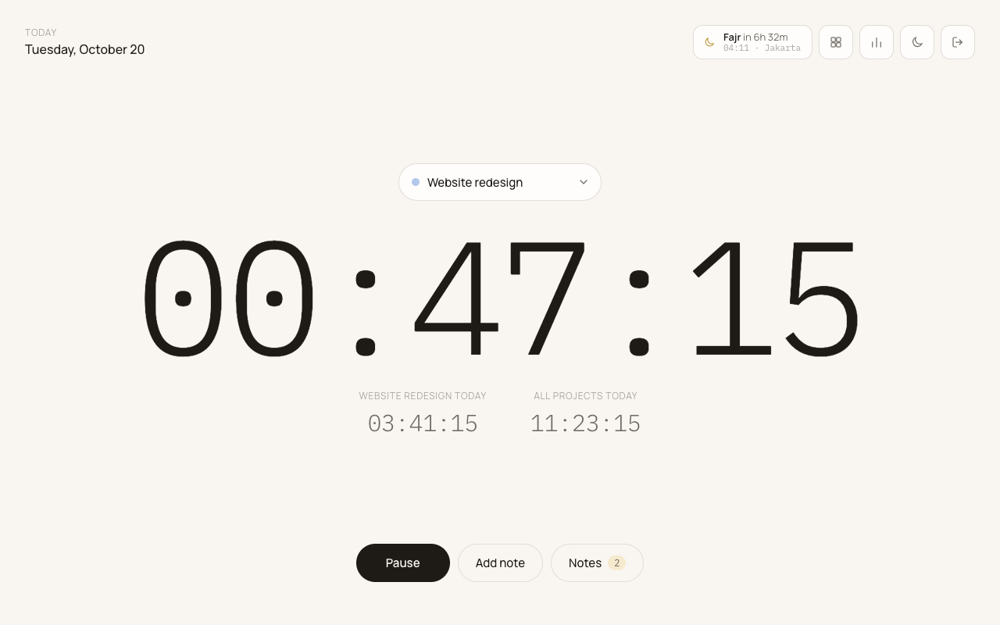
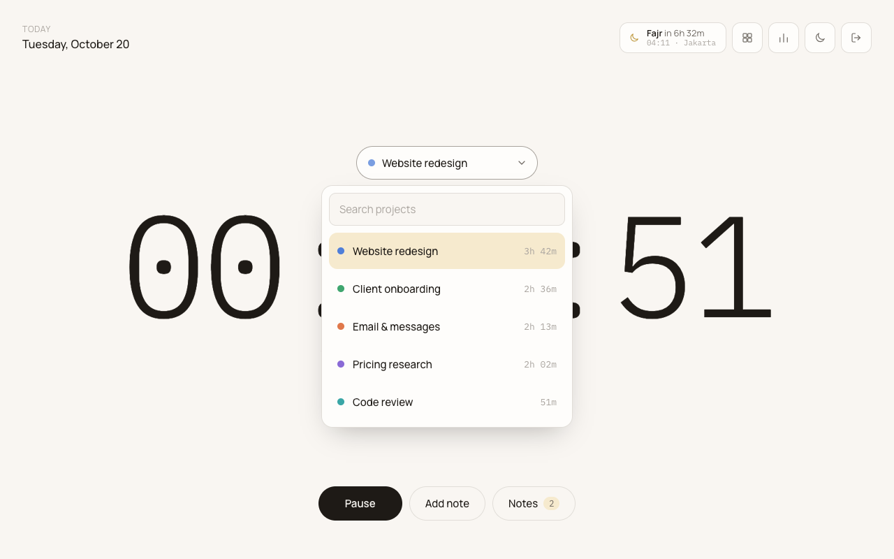
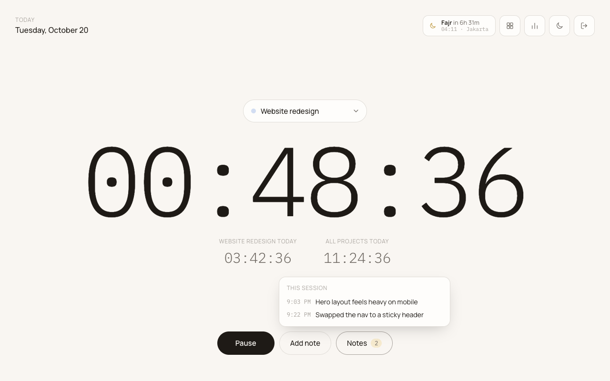
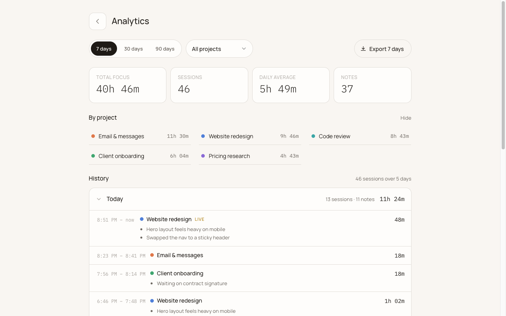
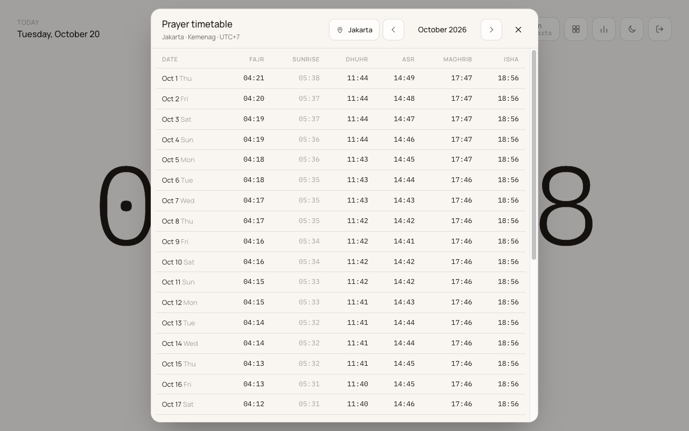

# HumiFocus

[](https://github.com/ikirifqi/humifocus/actions/workflows/ci.yml)
[](LICENSE)

A simple focus timer for people who constantly switch context. Pick what you are working on, and HumiFocus keeps time, notes, and history for every switch, so your day stays organized and tracked.

<picture>
	<source media="(prefers-color-scheme: dark)" srcset="docs/screenshots/home-dark.png" />
	
</picture>

## Features

- **One-click context switching.** Choose a project and the timer starts; switching closes the previous session automatically.
- **Pause and resume** without losing the session.
- **Session notes.** Jot down what you did or where you left off, attached to the running session.
- **Projects** with colors and the time logged on each.
- **Analytics** over 7, 30, or 90 days: total focus, daily average, time per project, a day-by-day history with notes, and CSV export.
- **Prayer timetable** for the next prayer and the whole month, with regional calculation methods for Jakarta, Kuala Lumpur, Dubai, Cairo, Istanbul, London, and New York. Upload a year of official times for any city as CSV, and every user can pick it.
- **Synced and offline-ready.** Your data follows your account across devices, and keeps working without a connection.
- **Light and dark themes.**

## Screenshots

| Switch projects                                                              | Notes for the running session                                 |
| ---------------------------------------------------------------------------- | ------------------------------------------------------------- |
|  |  |

| Analytics                                                                               | Prayer timetable                                         |
| --------------------------------------------------------------------------------------- | -------------------------------------------------------- |
|  |  |

## Tech stack

- [SvelteKit](https://svelte.dev/docs/kit) with Svelte 5 runes and TypeScript, compiled to a static single-page app
- [Firebase Authentication](https://firebase.google.com/docs/auth) for email and password sign-in
- [Cloud Firestore](https://firebase.google.com/docs/firestore) for data, with an offline cache
- [Cloudflare Pages](https://pages.cloudflare.com) for hosting, deployed from GitHub Actions

## Getting started

You need [Node.js](https://nodejs.org) 26 or later (pinned in `.node-version`) and [pnpm](https://pnpm.io).

HumiFocus needs a Firebase project to run. The repository holds no Firebase config, so before the first run, [set up your own Firebase project](#set-up-firebase) and put its config in `.env`.

```sh
git clone https://github.com/ikirifqi/humifocus.git
cd humifocus
pnpm install
cp .env.example .env    # then fill in your Firebase web app config
pnpm dev
```

The app opens at <http://localhost:5173>. Sign in with an account you added in the Firebase console.

### Scripts

| Command          | Purpose                                       |
| ---------------- | --------------------------------------------- |
| `pnpm dev`       | Start the dev server                          |
| `pnpm build`     | Build the static SPA into `build/`            |
| `pnpm preview`   | Serve the production build locally            |
| `pnpm check`     | Type-check Svelte and TypeScript sources      |
| `pnpm lint`      | Check formatting (Prettier) and lint (ESLint) |
| `pnpm format`    | Format all files with Prettier                |
| `pnpm timetable` | Write a prayer timetable CSV from api.co.id   |

## How it works

HumiFocus has no server of its own. The browser talks to Firebase directly, and `firestore.rules` makes sure each signed-in user can only read and write their own data, apart from the shared prayer timetables.

Each user's data lives under `users/{uid}` in Firestore:

| Path                        | Holds                                                                                 |
| --------------------------- | ------------------------------------------------------------------------------------- |
| `users/{uid}`               | Settings and the running timer, so a timer started on one device shows on all of them |
| `users/{uid}/projects/{id}` | Project name, color, and creation time                                                |
| `users/{uid}/sessions/{id}` | Finished sessions: project, start and end, time counted, and notes                    |

Uploaded prayer timetables are shared by every signed-in user. Each signed-in app downloads only the timetables of the city it shows:

| Path                             | Holds                                                                           |
| -------------------------------- | ------------------------------------------------------------------------------- |
| `prayerTimetables/{city}_{year}` | A year of prayer times for a city, its UTC offset, and who uploaded it and when |
| `prayerCities/{city}`            | The name of each city with an upload, for the location menu                     |

The app state in `src/lib/app.svelte.ts` mirrors live Firestore snapshots, and Firestore's local cache applies writes immediately, so the app stays responsive offline and catches up when the connection returns.

## Prayer timetable uploads

The timetable dialog's upload button takes a CSV with one row for every day of a year:

```csv
City,UTC offset,Date,Fajr,Sunrise,Dhuhr,Asr,Maghrib,Isha
Bandung,7,2026-01-01,04:14,05:35,11:55,15:22,18:10,19:27
```

The upload replaces any earlier one for the same city and year. If the city is one of the built-in ones, its times replace the calculated ones for that year; otherwise the city is added to the location menu.

For Indonesia, `pnpm timetable` writes this CSV from the [api.co.id](https://api.co.id/api-jadwal-waktu-sholat-imsyak-indonesia/) prayer times (Kemenag). It asks for your API key on each run and never stores it. api.co.id does not accept calls from the browser, which is why this runs locally.

```sh
pnpm timetable --search bandung        # find the regency code
pnpm timetable --regency 3204          # writes prayer-timetable-2026-bandung.csv
```

Add `--year 2027` for another year, `--city Bandung` to rename the city, or `--out file.csv` to choose the file.

To skip the key prompt, set `API_CO_ID_KEY` for that one command, such as from a file so the key stays out of your shell history:

```sh
API_CO_ID_KEY="$(cat path/to/api-key)" pnpm timetable --regency 3204
```

## Set up Firebase

Whether you run HumiFocus locally or deploy a fork, it needs a Firebase project of your own.

1. Create a project in the [Firebase console](https://console.firebase.google.com) and add a web app to it.
2. Under **Authentication**, enable the **Email/Password** sign-in provider. HumiFocus is invite-only: the app has no sign-up or password reset, so also turn off **Settings > User actions > Enable create (sign-up)**, or anyone can still create an account through the Firebase API. Add each user, yourself included, under **Users > Add user**.
3. Create a **Cloud Firestore** database.
4. Copy `.env.example` to `.env` and set `PUBLIC_FIREBASE_CONFIG` to the web app's config from **Project settings > Your apps**, written as JSON on one line inside single quotes:

   ```sh
   PUBLIC_FIREBASE_CONFIG='{"apiKey": "...", "authDomain": "...", "projectId": "...", "storageBucket": "...", "messagingSenderId": "...", "appId": "..."}'
   ```

   The console shows the config as a JavaScript object, so put the keys in double quotes. The build stops with an error if the JSON is invalid or lacks `apiKey`, `authDomain`, `projectId`, or `appId`.

   These values are compiled into the app and visible to anyone who loads it. They are not secrets: the security rules in `firestore.rules` are what protect the data.

5. Copy `.firebaserc.example` to `.firebaserc` and put your project ID in it, then deploy the security rules:

   ```sh
   pnpm dlx firebase-tools login
   pnpm dlx firebase-tools deploy --only firestore:rules
   ```

6. When you deploy the app, add its domain to **Authentication > Settings > Authorized domains**. `localhost` is allowed by default.

`.env` and `.firebaserc` are ignored by git, so your config stays out of the repository.

## Deployment

`pnpm build` writes a static SPA to `build/`, which any static host can serve if it falls back to `index.html` for unknown routes.

This repository deploys to [Cloudflare Pages](https://pages.cloudflare.com) with GitHub Actions:

- **CI** (`.github/workflows/ci.yml`) lints, type-checks, and builds every push and pull request.
- **Deploy** (`.github/workflows/deploy.yml`) runs by hand from the **Actions** tab on `main`. Enter a version such as `1.2.0` and it runs the checks, deploys the build to Cloudflare Pages, tags the commit `v1.2.0`, and publishes a GitHub release with the build attached. Versions with a suffix, such as `1.3.0-beta.1`, become prereleases.

To deploy a fork, first [set up Firebase](#set-up-firebase). Then, under **Settings > Secrets and variables > Actions**, add a `PUBLIC_FIREBASE_CONFIG` variable on the **Variables** tab holding the same JSON, which may span several lines there. CI builds with it, and a release stops if it is missing. It is a variable, not a secret, because it ends up in the public build anyway.

Add these repository secrets on the **Secrets** tab:

| Secret                  | Value                                                                            |
| ----------------------- | -------------------------------------------------------------------------------- |
| `CLOUDFLARE_API_TOKEN`  | A Cloudflare API token with the **Account > Cloudflare Pages > Edit** permission |
| `CLOUDFLARE_ACCOUNT_ID` | Your Cloudflare account ID                                                       |

The Pages project is named `humifocus` and is created on the first release. To use another name, set a `CLOUDFLARE_PROJECT_NAME` repository variable.

## Contributing

Contributions are welcome. Please read [AGENTS.md](AGENTS.md) first: it covers the project's architecture rules and its commit conventions (atomic [Conventional Commits](https://www.conventionalcommits.org)). Before opening a pull request, make sure `pnpm lint`, `pnpm check`, and `pnpm build` pass.

## License

HumiFocus is licensed under the [GNU Affero General Public License v3.0](LICENSE). If you run a modified version for others over a network, you must make its source available to them.
